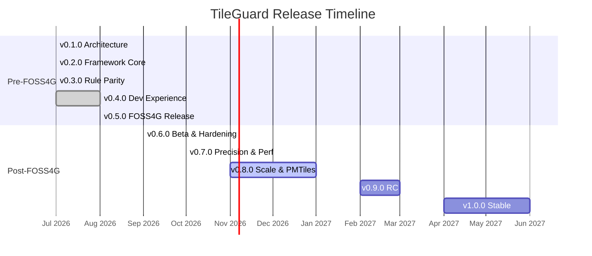

# Roadmap

TileGuard follows a dual-track strategy: internal **Phases** (engineering milestones) and public **Versions** (releases). The project is calibrated around the **FOSS4G 2026** presentation (Hiroshima, August 30, 2026).

## Current Status

**v0.7.0** — Complete framework across 9 packages, Guard 6 precision milestone achieved (100% precision & recall, 0 false positives on held-out corpus), Pillar 1 performance rules, SARIF reporter, streaming JSONL, and `--stdin` support. 1,848 tests passing across 9 packages.

## Release Timeline

## Phase Map

| Phase | Focus | Status |
|:------|:------|:-------|
| Phase 1 | Architecture & Contracts | ✅ Complete |
| Phase 2 | Framework Core (`@tileguard/core`) | ✅ Complete |
| Phase 3 | Domain Rules Migration (12 tile + 9 style) | ✅ Complete |
| Phase 4 | Developer Experience (Inspector, CLI) | ✅ Complete |
| Phase 5 | FOSS4G Quality Gate (FOSS4G 2026 release) | ✅ Complete |
| Phase 6 | Post-Conference (Pillar 1 performance, SARIF, scale, streaming) | 🔄 In Progress |
| Phase 7 | Production Stability & Python SDK | 📋 Planned |

## v0.5.0 — FOSS4G Release

The release presented at FOSS4G 2026 Hiroshima:

- ✅ 21 initial rules (12 tile + 9 style)
- ✅ Visual Inspector with diagnostic overlays
- ✅ CLI with initial suite (`check`, `compare`, `analyze`, `report`, `stats`, `doctor`, `style`, `rules`, `ver`, `init`)
- ✅ Comparison and regression detection
- ✅ Engineering report generation (Markdown, HTML, JSON)
- ✅ Convention-aware validation (MVT + OGC)
- ✅ CI/GitHub Actions integration
- ✅ Documentation site

## v0.7.0 — Precision Milestone & Performance (Current)

- ✅ **Guard 6 (`isProperCrossing`)** — 100% precision at 100% recall on dual-oracle corpus; 0 false positives on 1,800-tile held-out set
- ✅ **Pillar 1 Performance Rules** (`perf/tile-size`, `perf/vertex-budget`, `perf/feature-density`, `perf/layer-size`)
- ✅ **SARIF Reporter** (`--reporter sarif`) for GitHub Code Scanning
- ✅ **Streaming JSONL Reporter** (`--reporter jsonl`) for flat-memory large corpora
- ✅ **Stdin Input Mode** (`--stdin`) for Diff-Aware CI and pipe workflows
- ✅ **Tile Profiler** (`tileguard profile <file>`)
- ✅ **Pre-commit Hook Management** (`tileguard hook install|uninstall|status`)
- ✅ 25 total active rules (16 tile/perf + 9 style) and 13 CLI commands

## v0.8.0 — Scale & PMTiles (Next)

Expand the framework based on production pipeline requirements:

- **PMTiles support** — validate tiles directly from PMTiles archives (`--pmtiles planet.pmtiles`)
- **Tiered zoom sampling** — `--max-zoom` and `--sample-rate`
- **MBTiles provider** — SQLite-based archive validation
- **Render regression testing** — perceptual pixel comparison (Playwright-based)
- **IDE integration** — VS Code extension showing inline diagnostics

## v1.0.0 — Production Stable

The first stable release with backward-compatibility guarantees:

- **Stable API** — no breaking changes to Diagnostic, Rule, Plugin interfaces
- **Python SDK** — consume TileGuard from Python pipelines
- **Plugin marketplace** — community-contributed rule packages
- **Enterprise features** — custom reporters, shared configurations
- **Performance benchmarks** — published and tracked in CI

## Success Criteria

| Metric | Target |
|:-------|:-------|
| Adoption | CI quality gate in ≥ 3 major OSS geospatial projects within 12 months of v1.0 |
| Extensibility | ≥ 30% of rules contributed by community |
| Performance | 10,000 tiles validated in < 60s (CI environment) |
| Reliability | Zero false positives in structural validation |

## How to Influence the Roadmap

- **File issues** for features you need
- **Contribute rules** for validation gaps you encounter
- **Provide feedback** on the discussion board
- **Present TileGuard** at your local geo meetup

The roadmap prioritizes real user needs over speculative features. If you're using TileGuard in production, your feedback directly shapes what gets built next.
